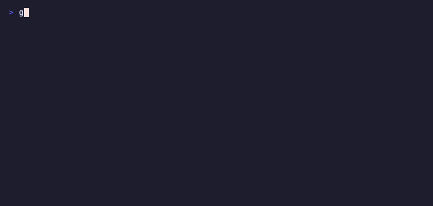

# GridPin

[](https://pypi.org/project/gridpin/)
[](https://crates.io/crates/gridpin)
[](https://duckdb.org/community_extensions/extensions/gridpin_ext)
[](https://gridpin.dev/mcp-geocoding)
[](LICENSE)
[](https://github.com/gridpin/gridpin/actions/workflows/ci.yml)
[](https://colab.research.google.com/github/gridpin/gridpin/blob/main/examples/colab_quickstart.ipynb)
[](https://gridpin.streamlit.app)

**A country in a file — offline forward and reverse geocoding.**



## Quick start

```console
$ pip install gridpin gridpin-mcp
$ gridpin-fetch fr    # France sheet, 365 MB, checked against the signed release; prints its path
```

```python
import gridpin
from gridpin_mcp import sheets

g = gridpin.Geocoder(str(sheets.download("fr")))  # no-op once the sheet is downloaded
g.geocode("1 rue de la Paix, Paris", 1)
```

No install: [try it in Colab](https://colab.research.google.com/github/gridpin/gridpin/blob/main/examples/colab_quickstart.ipynb)
— the Serbia sheet, forward, reverse and batch geocoding in five minutes.

Countries: `us` `de` `fr` `it` `es` `nl` `br` `rs` (`gridpin-fetch --list`). For AI agents there is an
MCP server — `claude mcp add gridpin -- uvx gridpin-mcp`, details in [mcp/README.md](mcp/README.md).
Everything after the download runs offline.

If GridPin is useful to you, [a star on GitHub](https://github.com/gridpin/gridpin) helps other people find it.

[GridPin](https://gridpin.dev) is an offline geocoder: a country in a data file, memory-mapped and ready in milliseconds, with no server, no database import, and no network. It resolves addresses to coordinates (forward) and coordinates to the nearest indexed address (reverse — approximate: streets are indexed by centroid, so each result carries its `distance_m`). On a single arm64 laptop core, measured on the France sheet: exact address lookups run at ~3,000/s, reverse geocoding at ~1,800/s, and typo-tolerant fuzzy matching much slower — tens of milliseconds per query, so batch it across cores when you feed it messy input. The engine and every query run fully offline — not a byte of what you geocode leaves your machine; the only network step is you downloading a sheet yourself, and a downloaded sheet carries no query data. Because you compute results locally from openly licensed data, you may store them forever, which hosted geocoding APIs typically forbid. If you have considered self-hosting Nominatim (a beefy server, days of import) or an on-prem geocoder license, the alternative here is: download one file, open it on any laptop.

## Install

**CLI** — prebuilt binaries for Linux x86_64 (`x86_64-unknown-linux-gnu`),
macOS Apple Silicon (`aarch64-apple-darwin`) and Windows x86_64
(`x86_64-pc-windows-msvc`) are attached to every
[GitHub release](https://github.com/gridpin/gridpin/releases); other targets
(Intel macOS, Linux arm64/musl, Windows arm) build from source:

```console
$ base=https://github.com/gridpin/gridpin/releases/download/v0.5.0
$ curl -fsSLO "$base/gridpin-aarch64-apple-darwin.tar.gz"
$ curl -fsSLO "$base/gridpin-release-signers"
$ curl -fsSLO https://dl.gridpin.dev/v0.5.0/attestation.json
$ curl -fsSLO https://dl.gridpin.dev/v0.5.0/attestation.json.sig
# the trust root comes from the OTHER channel — see "Verifying a release" for why
$ ssh-keygen -Y verify -f gridpin-release-signers -I gridpin-release \
    -n gridpin-g02 -s attestation.json.sig < attestation.json \
    || { echo "signature does not verify — STOP"; exit 1; }
$ want=$(python3 -c 'import json;print([a["sha256"] for a in json.load(open("attestation.json"))["assets"] if a["name"]=="gridpin-aarch64-apple-darwin.tar.gz"][0])')
$ test "$want" = "$(shasum -a 256 gridpin-aarch64-apple-darwin.tar.gz | cut -d' ' -f1)" \
    || { echo "archive does not match the signed attestation — STOP"; exit 1; }
$ tar xzf gridpin-aarch64-apple-darwin.tar.gz && sudo mv gridpin /usr/local/bin/
```

Yes, that is longer than `curl | tar`. Unpacking an archive runs its contents sooner or later, and
a checksum published beside the file it describes proves only that the download was not truncated —
whoever can replace one can replace both. The four extra lines are what makes it a check.

Or build from source with stable Rust: `cargo build --release --manifest-path gridpin/Cargo.toml`.

**Python** — `pip install gridpin`. This one
rests on PyPI's own integrity, not on the signature above: the attestation covers the artifacts we
publish ourselves. If you need the signed chain, take the wheel from the GitHub release and verify
it the same way as the CLI archive.

**DuckDB** — `INSTALL gridpin_ext FROM community;` then `LOAD gridpin_ext;`. The community
catalog builds and signs the extension itself, so that trust root is DuckDB's rather than ours.
It builds the current release only for the current DuckDB: that takes **DuckDB 1.5.6 or newer**;
older DuckDB versions install an older build. Check what you got with
`SELECT extension_version FROM duckdb_extensions() WHERE extension_name = 'gridpin_ext';`.
When the catalog is unreachable, or for the current release on DuckDB 1.5.5, download
`gridpin_ext-<platform>.zip` from the releases page: it is built for DuckDB 1.5.5 only. It is a loadable
extension, so authenticate it before you load it — same three lines as the CLI archive above,
with `gridpin_ext-<platform>.zip` as the asset name:

```console
$ ssh-keygen -Y verify -f gridpin-release-signers -I gridpin-release \
    -n gridpin-g02 -s attestation.json.sig < attestation.json \
    || { echo "signature does not verify — STOP"; exit 1; }
$ want=$(python3 -c 'import json;print([a["sha256"] for a in json.load(open("attestation.json"))["assets"] if a["name"]=="gridpin_ext-osx_arm64.zip"][0])')
$ test "$want" = "$(shasum -a 256 gridpin_ext-osx_arm64.zip | cut -d' ' -f1)" \
    || { echo "extension does not match the signed attestation — STOP"; exit 1; }
```

Then unzip it and `LOAD` the extracted `gridpin_ext.duckdb_extension` in a `duckdb -unsigned`
session — keep
that basename, DuckDB derives the entry symbol from it.

## Quick start

### CLI

```console
# forward: address -> coordinates, top 3 candidates
$ gridpin query france.bin "1 rue de la Paix Paris" -k 3

# reverse: coordinates -> nearest indexed address (approximate; each hit carries distance_m)
$ gridpin reverse france.bin 48.8686 2.3305

# batch: JSONL in ({"q": "..."} per line), JSONL out
$ gridpin batch france.bin queries.jsonl results.jsonl -k 1
```

### Python

```console
$ pip install gridpin
```

```python
import gridpin

g = gridpin.Geocoder("france.bin")
g.geocode("1 rue de la Paix Paris", 1)
g.reverse(48.8686, 2.3305, 1)
```

The wheel wraps the Rust engine directly (pyo3/maturin); on a single core, exact lookups run at ~3,000/s, while typo-heavy input is fuzzy-matched at tens of milliseconds per query — use `geocode_many()` to batch across cores.

### DuckDB

The `gridpin_ext` extension exposes five functions: `gridpin_load`, `gridpin_load_poi` (optional POI layer), `gridpin_reset`, `gridpin_geocode`, `gridpin_reverse`. One country per session — the loaded path may not change while it is loaded (a different path is an error, so a path column can never swap the index in the middle of a running query); to switch countries run `SELECT gridpin_reset();` (a standalone statement — it refuses to run inside a multi-row query) and load the new sheet. The loaded sheet is shared by every connection to the same database process: coordinate switches externally when several connections query concurrently.

```sql
LOAD gridpin_ext;
SELECT gridpin_load('france.bin');
SELECT gridpin_geocode(address)  FROM orders;
SELECT gridpin_reverse(lat, lon) FROM pings;
```

## Countries & data

A country in a file — most countries are a single file (a few regional datasets add a small companion file, and the optional POI layer is its own file). We call a country file a *sheet*, the full set an *atlas*, and a monthly data release *fresh sheets*.

| Country     | File size | Addresses | Source              | Data license          | POI layer |
|-------------|-----------|-----------|---------------------|-----------------------|-----------|
| United States | 1.45 GB | 95.33M | Overture / NAD + Census TIGER/Line; 7 states by address ranges only | open data (per source) | — |
| Germany     | 213 MB    | 19.27M    | Overture / OpenAddresses, 15 Länder; BNetzA postcode witness | dl-de/by-2-0 · dl-de/zero-2-0 · CC BY 4.0 (per source) | — |
| France      | 365 MB    | 26.1 M    | BAN (national registry) | Licence Ouverte   | ✓ (231 MB, optional) |
| Italy       | 247 MB    | 25.9 M    | Overture / ANNCSU   | CC BY 4.0             | — |
| Spain       | 185 MB    | 15.27M    | Overture / CartoCiudad (IGN/CNIG), all 52 postal provinces | CC BY 4.0 | — |
| Netherlands | 103 MB    | 9.9 M     | Overture / NGR (BAG) | Public Domain Mark 1.0 | — |
| Brazil | 677 MB | 67.19M | Overture / IBGE CNEFE 2022, nationwide | CC0 1.0 (IBGE public data) | — |
| Serbia      | 32 MB     | 2.6 M     | Overture / RGZ      | data.gov.rs Terms     | — |

**Germany covers 15 of 16 Länder; Bavaria is not covered.** In local spot checks, Bavarian queries
typically returned a distant same-named address with low confidence; less often, an empty answer.
Neither outcome establishes coverage. These spot checks illustrate failure modes, not population rates.
The release sheet contains 19,267,049 addresses,
213,315,143 bytes, and no POI layer. Per-Land providers and licenses are in [ATTRIBUTIONS.md](ATTRIBUTIONS.md).

POI coverage is per-country (see the table; we ship a layer only where source data is rich
enough to help). For France, pass the layer and
the engine cascades automatically — address index first, POI only on weak results, exact
addresses never overridden: `gridpin query france.bin "pharmacie gare de Lyon" --poi fr_poi.bin`
or `gridpin.Geocoder("france.bin", poi="fr_poi.bin")`.

The cascade precedence, identical for free-form and structured input:

| Address answer | POI answer | Winner |
|---|---|---|
| confident (e.g. exact house match) | — (not consulted) | address |
| weak (city-level / low confidence / weak fuzzy) | more confident | POI, flagged `poi_layer` |
| weak | equal or less confident | address (ties keep the address) |
| empty | any hit | POI, flagged `poi_layer` |
| empty | empty / no layer loaded | empty |

Structured input feeds EVERY provided token to the POI escalation, joined in the canonical
`street number postcode city` order — a number is often part of a place name ("Studio 54"). The
two input styles agree on the winner for address resolution and for POIs whose tokens are in that
canonical order. They can differ only when the fields you supply reorder the words of an
order-sensitive POI *name* (splitting "54 Studio" into `street:"studio", number:"54"` re-forms it as
"Studio 54"); pass such a query as free-form to keep the original word order.

Sizes are for v7 builds (August 2026; Germany repacked 2026-09-10; Spain added 2026-09-28; Brazil added 2026-10-11; the United States added 2026-10-24); the exact byte sizes are checked against a pinned source of truth in CI. A sheet is smaller than its own raw source: France's registry download is an 885 MB gzip that unpacks to 4.9 GB of CSV, while the finished sheet — the same 26.1M addresses plus every index (typo automata, spatial cells, ranking) — is 365 MB, ready to query.

**Download sheets.** Free builds of all available countries are served as individual files —
there is no directory listing, so link straight to the object you want:
[`usa.bin`](https://dl.gridpin.dev/v0.5.0/usa.bin) (1.45 GB),
[`germany.bin`](https://dl.gridpin.dev/v0.5.0/germany.bin) (213 MB),
[`france.bin`](https://dl.gridpin.dev/v0.5.0/france.bin) (365 MB),
[`italy.bin`](https://dl.gridpin.dev/v0.5.0/italy.bin) (247 MB),
[`spain.bin`](https://dl.gridpin.dev/v0.5.0/spain.bin) (185 MB),
[`netherlands.bin`](https://dl.gridpin.dev/v0.5.0/netherlands.bin) (103 MB),
[`brazil.bin`](https://dl.gridpin.dev/v0.5.0/brazil.bin) (677 MB),
[`serbia.bin`](https://dl.gridpin.dev/v0.5.0/serbia.bin) (32 MB), plus the optional France POI layer
[`fr_poi.bin`](https://dl.gridpin.dev/v0.5.0/fr_poi.bin) (231 MB). The matching `SHA256SUMS` manifest (covering the
engine binary and every sheet) is on the [GitHub release](https://github.com/gridpin/gridpin/releases).
Subscribers fetch fresh monthly builds from a keyed URL instead — see
[gridpin.dev/docs](https://gridpin.dev/docs).

## Quality

GridPin is built for addresses as people type them — typos, shortened street types, missing
commas, the town written first. Share of queries whose first answer lands within 150 m of an
independent reference coordinate (empty answers count as misses):

| Query set | Rows | GridPin | Photon | Nominatim |
|---|---:|---:|---:|---:|
| United States · distorted addresses | 3,655 | **32.7%** | 28.5% | 24.3% |
| United States · historic-places register (as recorded) | 1,000 | **64.0%** | 38.9% | 52.3% |
| Germany · distorted addresses | 2,000 | **82.1%** | 46.9% | 15.8% |
| Germany · clean addresses | 2,000 | **82.8%** | 83.2% | 81.2% |
| Spain · distorted addresses | 1,590 | **33.8%** | 29.6% | 20.8% |
| Brazil · distorted addresses | 2,376 | **20.7%** | 19.8% | 9.6% |
| Brazil · health-facility register (as typed) | 1,000 | **36.8%** | 28.2% | 20.7% |

*Distorted* means each real address was changed by one fixed mechanical rule, with the reference
coordinate kept byte for byte. On German and Spanish distorted addresses GridPin leads both services;
on Brazilian distorted addresses GridPin and Photon are level, both well ahead of Nominatim; on clean
German addresses GridPin and Photon are level (p=0.6691367 — not proof of parity). We show the sets
where GridPin leads or is level; on the other Spanish sets Photon leads, and on clean Brazilian
addresses Photon leads too. Counts, paired tests and data fingerprints for every set are in
[docs-public/BENCHMARK.md](docs-public/BENCHMARK.md); the summary lives on the
[test bench page](https://gridpin.dev/bench).

**Compatibility.** GridPin answers in the Photon API format, forward and reverse (the reverse
endpoint is implemented since 2026-08-06). On the external geocoder-tester suite — a compatibility
fixture set, not an accuracy oracle — the full official Alsace numbered-address file passes
**230/285** (2026-08-07; 0 → 173 → 208 → 230 as the adapter matured).

Two more axes where the comparison is not close: **speed** — ~3,000 exact lookups per second on a
single arm64 core, with no network round-trip — and **cost and privacy**: no per-query fee at any
volume, and not one query leaves your machine.

CI runs `cargo test` on three operating systems, plus a public smoke test that builds a tiny Monaco
sheet from an OSM extract and runs live queries against it.

## How it works

A country sheet is a single self-contained index file designed to be memory-mapped: opening it is effectively instant, there is no import into a database and no daemon to keep warm, and the first query returns in milliseconds from a cold start. Inside the file, sections are laid out for lazy access: an FST over the normalized lexicon for exact and prefix matching, spatial cells for reverse lookup and proximity ranking, typo automata for bounded-edit-distance fuzzy matching, and optional ML sections for query parsing and candidate ranking. The engine touches only the pages a query needs, which is why lookups stay in the millisecond range even on modest hardware.

Country-specific behavior lives in the data, not the binary. Normalization and parsing rule tables ship inside the sheet itself as a dedicated section, so a monthly data release can fix a country's quirks — abbreviations, renamed streets, administrative reshuffles — without an engine upgrade; engine and data are versioned independently. This repository contains the public parts: the Rust engine and CLI, the Python bindings, the DuckDB extension, the data pipeline (DuckDB SQL under `prep/`), and the docs. The rule tables (shipped inside paid data files), the evaluation corpora, and the ML training code are private.

## Verifying a release

Every release is covered by one signed attestation. The signature spans the **asset graph** — the
sheets, the binaries and this checker, each by size and two hashes. It does **not** cover
`SHA256SUMS` itself: that file lists the proofs, so it cannot be inside them. The checksums are
still pinned, because every line in them must match the signed graph — but the authority is the
attestation, not the checksum file. Two properties make the check worth anything, and
both are about **order and source**, not about running more commands.

**The trust root never comes from the channel it checks.** `gridpin-release-signers` (the public
half of the signing key) and `verify_release.py` come from the **GitHub release**; the data files
and the proofs come from `dl.gridpin.dev`. Whoever controls one channel cannot hand you both a
forged file and the key that blesses it.

**Nothing you downloaded runs until it has been authenticated.** `verify_release.py` is an ordinary
Python program: running it first and checking signatures afterwards would mean executing an
untrusted download. Steps 3–5 below use only `ssh-keygen` and `shasum`, which you already trust,
and only step 6 runs our code.

```bash
mkdir gridpin-v0.5.0 && cd gridpin-v0.5.0
mkdir trust data          # two directories on purpose: the checker never sits in what it checks
gh_base=https://github.com/gridpin/gridpin/releases/download/v0.5.0

# 1. TRUST ROOT — from GitHub, never from the download host
curl -fsSL -o trust/gridpin-release-signers "$gh_base/gridpin-release-signers"
curl -fsSL -o trust/verify_release.py       "$gh_base/verify_release.py"

# 2. Data and proofs — from the download host
for f in france.bin germany.bin italy.bin netherlands.bin serbia.bin fr_poi.bin spain.bin brazil.bin usa.bin \
         SHA256SUMS attestation.json attestation.json.sig; do
  curl -fsSL -o "data/$f" "https://dl.gridpin.dev/v0.5.0/$f"
done

# 3. The key is the one published below — compare by eye, before anything else
ssh-keygen -lf trust/gridpin-release-signers
#    expected: SHA256:Y1Q/c9oMgST5VkyU78Py/XM5QiQP8KXwe0fopZA+YXA

# 4. The attestation really is signed by that key (system ssh-keygen, not our code)
ssh-keygen -Y verify -f trust/gridpin-release-signers -I gridpin-release \
           -n gridpin-g02 -s data/attestation.json.sig < data/attestation.json \
  || { echo "signature does not verify — STOP"; exit 1; }

# 5. The checker you downloaded is the one that signature covers.
#    Its expected hash comes out of the attestation you just authenticated.
want=$(python3 -c 'import json;print([a["sha256"] for a in json.load(open("data/attestation.json"))["assets"] if a["name"]=="verify_release.py"][0])')
test "$want" = "$(shasum -a 256 trust/verify_release.py | cut -d" " -f1)" \
  || { echo "checker does not match the signed attestation — STOP"; exit 1; }

# 6. Only now run it, from outside the directory it judges.
python3 trust/verify_release.py --dir data --channel r2 \
        --allowed-signers trust/gridpin-release-signers \
        --expected-public-sha <commit from release notes>
```

Expected output: `OK: owner signature verified; N assets, checksums and attestation agree`.
Any other exit code means **do not use the files**.

Step 3 is the one thing a machine cannot do for you. The published fingerprint is

```
SHA256:Y1Q/c9oMgST5VkyU78Py/XM5QiQP8KXwe0fopZA+YXA
```

If it ever differs and no signed announcement explains the change, stop and write to
contact@gridpin.dev.

## Data licensing & attribution

The engine is Apache-2.0. Each sheet carries the license of its source data:

- **United States** — National Address Database (USDOT) and 19 state and county open datasets via Overture/OpenAddresses, each under its own permissive licence (U.S. Government work, CC0, PDDL, CC BY 4.0, open-data terms — listed per source in the sheet manifest); address ranges from U.S. Census Bureau TIGER/Line 2025 (U.S. Government work); postal codes from GeoNames (CC BY 4.0).
- **France** — BAN, under [Licence Ouverte 2.0](https://www.etalab.gouv.fr/licence-ouverte-open-licence/).
- **Italy** — ANNCSU via Overture/OpenAddresses, under [CC BY 4.0](https://creativecommons.org/licenses/by/4.0/).
- **Netherlands** — Nationaal Georegister (BAG) via Overture, under [Public Domain Mark 1.0](https://creativecommons.org/publicdomain/mark/1.0/).
- **Serbia** — RGZ via Overture, under [data.gov.rs Terms of use](https://data.gov.rs/sr/terms/); settlement-name aliases from GeoNames (CC BY 4.0).
- **POI layer** — Overture places, mixed permissive: CDLA-Permissive-2.0 (Meta, Microsoft, …), Apache-2.0 (Foursquare), CC0-1.0 (AllThePlaces).

Per the [Overture attribution page](https://docs.overturemaps.org/attribution/), addresses are not one blanket license — each national source carries its own. Consult your own counsel before commercial redistribution.

All of these licenses let you **store geocoding results indefinitely**. This is a real difference from hosted APIs: Google's terms forbid storing results and allow caching coordinates for at most 30 days, and Mapbox charges roughly 7.5× for permanent storage — at list prices of about $3,550 (Google) to $4,500 (Mapbox) per million requests per month before you even ask to keep the output (List prices as of 2026-08, 1M requests/month; see the linked provider terms). With GridPin the computation happens on your hardware, so the results are yours from the start. The grid is ours. The pin is yours.

This also matters for GDPR: the addresses you geocode are often customer data, and with GridPin they never leave your infrastructure.

## Status & roadmap

**v0.5.0: the United States added. Client update required.** One nationwide sheet (`usa.bin`, 1.45 GB): 95.33M point addresses from sources with an explicit right to redistribute (National Address Database, New York City, Los Angeles, Oakland County, MassGIS, MnGeo, Oregon and other state and county open data) plus 34.52M address-range points from Census TIGER/Line 2025 where no point addresses exist. Point addresses cover 35 states; in CO, FL, HI, MS, NH, NV and SC answers are interpolated from address ranges (tens to hundreds of metres). Older engines have no US rules (trailing street types, directions, ZIP+4, state tails). Use the 0.5.0 client with this release. All eight country sheets and the France POI layer use the new immutable `v0.5.0/` path and a new attestation; `v0.1.0/` to `v0.4.0/` are unchanged.

**v0.4.0: Brazil added. Client update required.** Brazil is one nationwide sheet covering 26 states and the Federal District; the source counts describe source presence, not address completeness. Spain covers all 52 postal provinces (incl. Ceuta and Melilla). Germany covers 15 of 16 Länder; Bavaria is not covered. Use the 0.4.0 client with this release: older engines do not contain the Brazilian rules. All seven country sheets and the France POI layer use the new immutable `v0.4.0/` path and a new attestation; `v0.1.0/`, `v0.2.0/` and `v0.3.0/` are unchanged.

For an existing Python installation, use `pip install --upgrade gridpin==0.5.0`, not a plain install that may keep an older version.

Interfaces and file formats may still change before v1.0. Sheets are tied to the engine's format major version — keep the engine build that shipped alongside your sheets; before v1.0 a newer engine may require newer sheets.

Planned distribution:

- **Free** — static builds of all available countries, with no update schedule. Free builds carry the same curated rules section subscribers get — you trade freshness, not quality; fresh monthly sheets are what subscriptions are for.
- **Starter, $59/mo** — a subscription: one country of your choice, a fresh sheet every month.
- **Pro, $149/mo** — a subscription: the full atlas (all available countries), fresh sheets monthly, provenance journal per build, invoice billing, priority email support.
- **Snapshot, $199 one-time** — *this month's* fresh build of all available countries (the same sheets subscribers get), with an invoice, without a subscription. No updates afterwards. It costs more than one month of Pro on purpose: it is the no-subscription option — one invoice for procurement, no card on file, nothing to cancel. If a subscription works for you, a month of Pro is cheaper.
- **OEM / embedding** — from $1,500/yr.

Prices above describe what is planned; they are not binding and nothing is on sale yet.

## License

The code in this repository is licensed under [Apache-2.0](LICENSE). Data files are licensed separately by source — see [Data licensing & attribution](#data-licensing--attribution).
